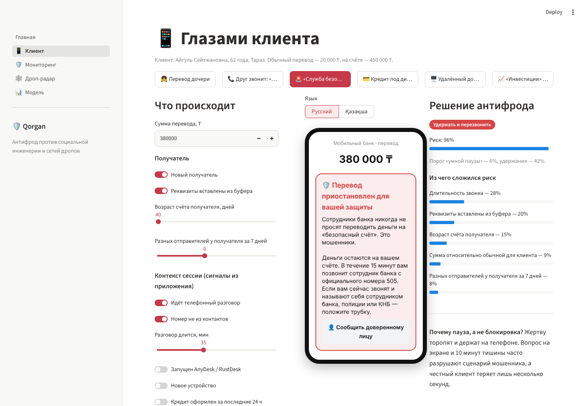
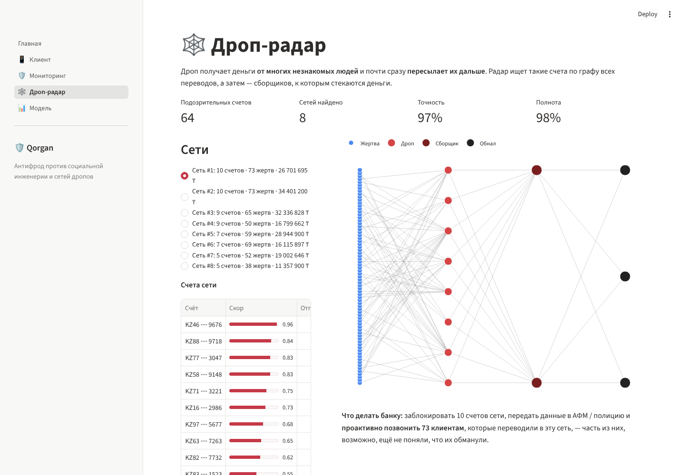
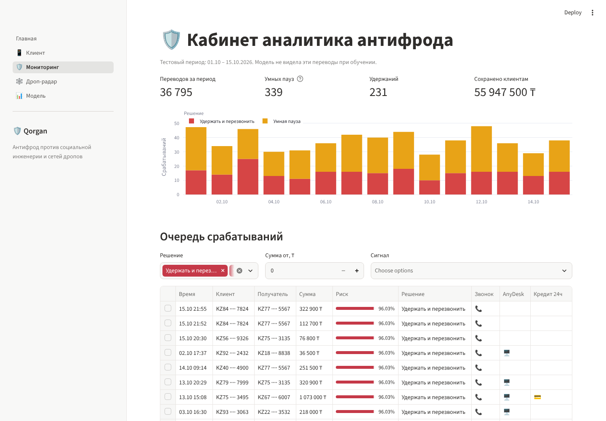

# 🛡️ Qorgan — антифрод против социальной инженерии и сетей дропов

> **ITU Hackathon 2026 · кейс Банка ЦентрКредит «Инновации в банкинге и кибербезопасность»**
>
> *Qorgan* (каз. «қорған») — защита, крепость.

Qorgan замечает, что клиента **уговаривают** перевести деньги, мягко останавливает перевод
**«умной паузой»** на русском или казахском языке и находит **сети дропов**, через которые
выводятся украденные деньги.

**📑 Презентация:** [docs/Qorgan_ZhanLI_presentation.pdf](docs/Qorgan_ZhanLI_presentation.pdf)

**▶️ Живое демо:** https://qorgan-antifraud-knnai7fwmhudrcnfhmamal.streamlit.app/



## Проблема

- За январь–ноябрь 2025 года в Казахстане зарегистрировано **26,3 тыс.** случаев интернет-мошенничества
  (**+20%** к прошлому году), ущерб — **11,2 млрд ₸**, причём **96,7%** ущерба несут физлица.
  В полицию обращается лишь каждый пятый пострадавший. — *КПСиСУ Генпрокуратуры, [informburo.kz](https://informburo.kz/novosti/rekordnoe-kolicestvo-skolko-slucaev-mosennicestva-v-seti-zaregistrirovali-v-kazaxstane-v-2025-godu)*
- Главный тренд — **социальная инженерия**: «служба безопасности банка», «следователь», «кредит под диктовку».
  Клиент сам вводит пароль и сам подтверждает перевод — для классических правил это обычная операция.
- Деньги уходят через **дропов**. С 16.09.2025 действует ст. 232-1 УК РК о дропперстве;
  большинство подозреваемых — молодёжь 18–29 лет. — *[czhr.kz](https://www.czhr.kz/post/%D0%B4%D1%80%D0%BE%D0%BF%D0%BF%D0%B5%D1%80%D1%81%D1%82%D0%B2%D0%BE-%D0%B2-%D0%BA%D0%B0%D0%B7%D0%B0%D1%85%D1%81%D1%82%D0%B0%D0%BD%D0%B5-17-%D1%83%D0%B3%D0%BE%D0%BB%D0%BE%D0%B2%D0%BD%D1%8B%D1%85-%D0%B4%D0%B5%D0%BB-%D1%83%D0%B6%D0%B5-%D0%B4%D0%BE%D1%88%D0%BB%D0%B8-%D0%B4%D0%BE-%D1%81%D1%83%D0%B4%D0%B0), [fingramota.kz](https://fingramota.kz/ru/who-is-droppers)*

## Решение — три слоя

| Слой | Что делает |
|---|---|
| **1. Сигналы сессии** | Мобильное приложение банка передаёт контекст перевода: идёт ли звонок с неизвестного номера и как долго, запущен ли AnyDesk/RustDesk, вставлены ли реквизиты из буфера, оформлен ли кредит за последние 24 часа, новое ли устройство. Модель оценивает риск перевода. |
| **2. Умная пауза** | Средний риск — предупреждение под конкретную схему на **русском или казахском**, 3 вопроса и пауза 10 минут, кнопка «сообщить доверенному лицу». Высокий риск — перевод удерживается, банк перезванивает с официального номера. Честный клиент теряет секунды, жертва получает время «выйти из-под гипноза». |
| **3. Дроп-радар** | Граф всех переводов: счета, которые получают деньги от многих незнакомых людей и пересылают их дальше в течение 24 часов, затем — сборщики, к которым стекаются деньги, и целые сети. Банк блокирует сеть и **проактивно звонит пострадавшим**. |

## Результаты (тестовый период, 15 дней, 36 795 переводов, 170 мошеннических)

| | Классические правила | **Qorgan** |
|---|---|---|
| Поймано мошеннических переводов | 41% | **96%** |
| Сохранено суммы | 85% | **99,6%** |
| Лишних срабатываний на честных переводах | 0,21% | 1,1% (из них 0,9% — лишь пауза с вопросом) |
| **При одинаковых 0,21% лишних срабатываний** (только «удержание») | 41% | **90%** |

ROC-AUC 0,994 · PR-AUC 0,898 · Дроп-радар: найдены **все 8 сетей**, точность 97%, полнота 98%.

| Схема | Правила | Qorgan |
|---|---|---|
| Звонок «службы безопасности» / «безопасный счёт» | 45% | **100%** |
| Кредит под диктовку | 84% | **100%** |
| Удалённый доступ (AnyDesk/RustDesk) | 65% | **100%** |
| Фейковые инвестиции | 15% | **94%** |
| Предоплата на маркетплейсе | 5% | **85%** |

> ⚠️ **Данные синтетические.** Реальных данных банка у нас нет, поэтому мы смоделировали
> 4 000 клиентов, 110 тыс. переводов, 5 схем мошенничества и 8 сетей дропов по публичным описаниям.
> Метрики показывают, что подход работает. На реальных данных они будут ниже — следующий шаг
> это пилот на обезличенных данных банка.

## Демо

| Страница | Что показывает |
|---|---|
| 🏠 Главная | Проблема, решение, ключевые метрики |
| 📱 Клиент | Симулятор: 6 сценариев, переключатели сигналов, экран телефона с умной паузой (RU/KZ), объяснение риска |
| 🛡️ Мониторинг | Кабинет аналитика: очередь срабатываний, фильтры, объяснение каждого решения |
| 🕸️ Дроп-радар | Граф сети: жертвы → дропы → сборщики → обнал |
| 📊 Модель | Сравнение с правилами, PR-кривая, методология, ограничения, этика |




### Запуск

```bash
pip install -r requirements.txt
python scripts/build.py          # данные + обучение + метрики (~20 сек)
streamlit run app/Главная.py
```

При первом запуске приложение само вызовет `build.py`, если данных ещё нет.
Тесты: `python -m pytest -q tests`.

## Как устроено

```
qorgan/
  data_gen.py   генератор клиентов, переводов, 5 схем мошенничества и сетей дропов
  features.py   17 «причинных» признаков (только данные, доступные в момент перевода)
  model.py      градиентный бустинг, пороги решений, объяснения по Шепли, сравнение с правилами
  graph.py      дроп-радар: профиль счёта, распространение подозрения, поиск сетей
  policy.py     тексты умной паузы на русском и казахском
app/            Streamlit-приложение (5 страниц)
scripts/build.py  полный пайплайн
tests/          проверки: нет утечек, модель лучше правил, радар находит дропов
```

- **Модель:** `HistGradientBoostingClassifier` (scikit-learn), разбиение **по времени** (30 дней — обучение,
  15 — проверка). Пороги: умная пауза — не более 1% честных переводов, удержание — не более 0,15%.
- **Объяснимость:** вклад каждого сигнала по значениям Шепли (принцип SHAP) относительно типичного честного перевода.
- **Этика:** возраст, пол и город клиента в модель **не входят** — модель реагирует на ситуацию, а не на человека.
- **Дроп-радар:** скор = доля рискованных входящих + быстрый транзит (≥3 отправителей) + число отправителей +
  молодость счёта; второй проход — доля денег от уже подозрительных счетов (находит сборщиков);
  сети — связные компоненты.

## Внедрение в банке

1. **SDK в мобильном приложении** собирает сигналы сессии (состояние звонка — Android `TelephonyManager`,
   iOS `CallKit`; список запущенных приложений удалённого доступа; события вставки из буфера).
   Данные о звонке — только факт и длительность, без содержимого разговора.
2. **Скоринг-сервис** (< 50 мс) встраивается перед подтверждением перевода рядом с текущей антифрод-системой.
3. **Дроп-радар** пересчитывается раз в час по графу переводов; найденные сети идут аналитикам,
   в АФМ и в Антифрод-центр Нацбанка.
4. **A/B-тест текстов** умной паузы: какая формулировка чаще останавливает жертву.

## Дорожная карта

- Пилот на обезличенных данных банка, переобучение модели.
- Голосовой антифрод: распознавание сценария мошенника в звонке (с согласия клиента).
- Обмен данными о счетах дропов между банками.
- Режим «доверенное лицо» для пожилых клиентов: крупные переводы подтверждает родственник.

## Команда

**ZhanLI** — Раева Алина (КазНУ, Алматы), индивидуальное участие.
V региональный ITU Hackathon 2026, International Taraz University.
